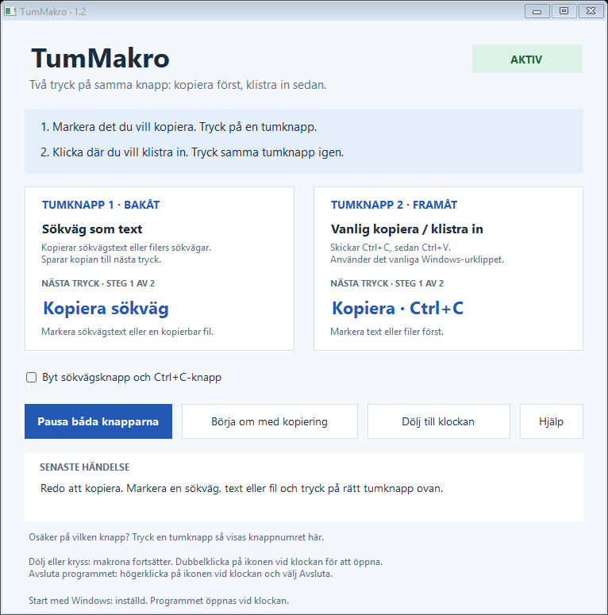

# TumMakro

Två tumknappar. Ett tryck kopierar, nästa tryck på samma knapp klistrar in. Efter inklistringen börjar knappen om med kopiering.



## Vilken knapp gör vad?

| Knapp som standard | Första trycket | Nästa tryck |
|---|---|---|
| Tumknapp 1, normalt Bakåt | Kopierar markerad sökvägstext eller hämtar kopierade filers sökvägar | Klistrar in den sparade kopian som text |
| Tumknapp 2, normalt Framåt | Skickar Ctrl+C | Skickar Ctrl+V |

**Sökvägsknappen har ingen spärr till Utforskaren.** Du kan markera sökvägstext i en editor, textruta, terminal, webbsida eller ett annat program som stöder Ctrl+C. Du kan också markera filer eller mappar i ett program som kopierar filinformation till Windows-urklippet. TumMakro hämtar då sökvägarna och klistrar senare in dem som text, en sökväg per rad.

Programmet kräver inte att texten har en viss sökvägsform eller att filen finns på den här datorn. Det accepterar bland annat Windows-sökvägar, nätverkssökvägar, relativa sökvägar, Unix-sökvägar och URL:er. Programmet du kopierar från måste lämna text eller filinformation i urklippet; TumMakro kan inte härleda en dold sökväg ur en filikon som programmet inte kan kopiera. Kopiering använder Ctrl+C, inte ett specialkommando för Utforskaren.

Sökvägsknappen sparar sin kopia tills du klistrar in. Om du kopierar annat under tiden klistrar den ändå in den sparade sökvägen. Omgivande citattecken på en rad tas bort. Flera kopierade filer ger flera sökvägsrader.

**Ctrl+C/Ctrl+V-knappen använder det vanliga Windows-urklippet.** Den kan kopiera och klistra in text eller filer, beroende på vilket program du använder. Om du ändrar urklippet mellan trycken klistrar nästa tryck in det nya innehållet. Utan markering kan Ctrl+C lämna gammalt innehåll i urklippet.

## Så använder du knapparna

1. Markera det du vill kopiera och tryck rätt tumknapp.
2. Klicka där du vill klistra in och tryck **samma tumknapp** igen.
3. Nästa tryck på den knappen kopierar något nytt.

Varje knapp har ett eget kort. Kortet visar knappnumret, vad knappen kopierar och **vad nästa tryck gör**. Radens steg 1 av 2 betyder kopiering; steg 2 av 2 betyder inklistring. Knappkorten visar Pausad när makrona är pausade.

## Reglagen i programmet

| Reglage | Vad det gör |
|---|---|
| **Pausa båda knapparna** | Stoppar makrona och låter tumknapparna fungera som vanligt. Välj Aktivera makron för att fortsätta. |
| **Börja om med kopiering** | Återställer båda knapparnas växling. Nästa tryck kopierar. Innehållet i Windows-urklippet finns kvar. |
| **Byt sökvägsknapp och Ctrl+C-knapp** | Byter vilken tumknapp som har vilken funktion. Båda börjar om med kopiering. Ditt val sparas. |
| **Dölj till klockan** eller fönstrets kryss | Döljer fönstret. Makrona fortsätter att köra. |
| **Hjälp** | Förklarar knapparna, arbetsflödet och felsökningen. |
| **Avsluta** i ikonens högerklicksmeny | Stoppar programmet och makrona. |

Dubbelklicka på ikonen vid klockan för att öppna fönstret igen. Ikonen kan ligga under pilen för dolda ikoner.

## Hämta och kör

Hämta **TumMakro.exe** från [senaste utgåvan](https://github.com/sp1e/TumMakro/releases/latest) och dubbelklicka för att öppna programmet. Det kräver 64-bitars Windows och .NET Framework 4.x. Det finns inga externa bibliotek att installera.

## Starta med Windows

Hämta också **Installera-autostart.ps1** från utgåvan och lägg den i samma mapp som TumMakro.exe. Kör från den mappen:

```powershell
powershell -NoProfile -ExecutionPolicy Bypass -File .\Installera-autostart.ps1
```

Skriptet kopierar programmet till `%LOCALAPPDATA%\TumMakro\TumMakro.exe` och registrerar autostart för det aktuella Windows-kontot. Vid inloggning startar det med `--background`: fönstret är dolt, ikonen finns vid klockan och makrona är aktiva. Du kan flytta den ursprungliga programfilen utan att autostarten påverkas.

För att ta bort autostarten men behålla programfilerna:

```powershell
powershell -NoProfile -ExecutionPolicy Bypass -File .\Installera-autostart.ps1 -Avinstallera
```

Du kan också inaktivera TumMakro i Windows inställningar för startappar. Autostarten använder värdet `TumMakro` under `HKEY_CURRENT_USER\Software\Microsoft\Windows\CurrentVersion\Run` och kräver inga administratörsrättigheter.

## Om en knapp inte fungerar

Kontrollera att du har markerat innehållet och att programmet stöder vanlig kopiering. Släpp Ctrl, Shift, Alt och Windows-tangenten innan du använder tumknappen. Windows kan blockera simulerade tangenttryckningar till program som körs med högre behörighet.

Tumknapparna behöver rapporteras som Windows extraknappar 1 och 2, vanligen **Mouse Button 4 / Back** och **Mouse Button 5 / Forward**. Om Razer Synapse skickar en tangent eller ett eget makro behöver du återställa knappens standardfunktion. Raden **Senaste tryck** visar vilken knapp Windows rapporterar.

## Data och testning

TumMakro gör inga nätverksanrop och sparar inget kopierat innehåll på disk. Det sparar knappordningen i `%LOCALAPPDATA%\TumMakro\settings.txt`. Programmet har de två makrona ovan; det är ingen generell redigerare för tangentsekvenser.

Bygg källkoden i `src/TumMakro.cs` med Windows .NET Framework-kompilator:

```powershell
powershell -NoProfile -ExecutionPolicy Bypass -File .\Bygg.ps1
.\TumMakro.exe --self-test .\self-test.txt
.\TumMakro.exe --self-test-background .\background-test.txt
```

Makrotestet behöver ett interaktivt Windows-skrivbord. Det provar kopiering av sökvägstext i ett vanligt textfönster utanför Utforskaren, kopierade filers sökvägar, nätverkssökvägar, sparad kopia, knappbyte, paus och återställning. Bakgrundstestet kontrollerar dolt fönster, ikon och aktiv knappavläsning. Simulerade filkopieringsdata i testet motsvarar standardformatet FileDrop; testet bevisar inte att varje tredjepartsprogram eller Razer-profil lämnar samma data.
